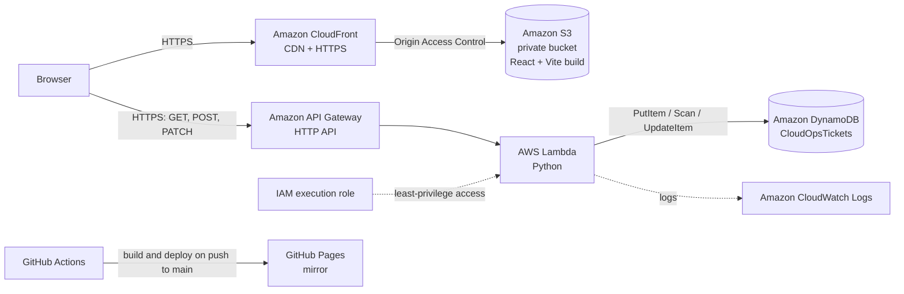

# CloudOps Helpdesk

A serverless IT support-ticket system on AWS. Employees raise tickets and track them in an **Employee Portal**; the support team reviews and updates them in an **Admin Dashboard**. The React + Vite frontend is served over HTTPS by **Amazon CloudFront** from a **private S3 bucket**, and the backend runs on API Gateway, Lambda and DynamoDB in `ap-south-1` (Mumbai).

**Live demo (CloudFront)**

- Employee Portal: https://dpdx3rbgfvdsz.cloudfront.net/
- Admin Dashboard: https://dpdx3rbgfvdsz.cloudfront.net/admin.html

A mirror is also deployed to GitHub Pages by GitHub Actions: [portal](https://dhruvpatel99.github.io/cloudops-helpdesk-aws/) · [admin](https://dhruvpatel99.github.io/cloudops-helpdesk-aws/admin.html).

> **Demo only.** Authentication is not enabled yet, so please don't enter personal or sensitive information in tickets. Amazon Cognito login is the next milestone (see [Roadmap](#roadmap)).

---

## Features

| Employee Portal | Admin Dashboard |
| --- | --- |
| Create a ticket (title up to 120 characters, description up to 2,000) | Ticket counts: total, open, in progress, resolved |
| See all tickets with status and creation time | Search by title, description or ticket ID |
| Search and filter by status | Filter by status |
| Open a ticket to read its details | Change a ticket's status (OPEN, IN_PROGRESS, CLOSED) |
| Refresh to sync with the API | Ticket details view and refresh |

Statuses use the same colours on both pages: **Open** amber, **In progress** blue, **Closed** green.

## Architecture



1. The browser loads the static frontend from CloudFront. CloudFront reads it from a private S3 bucket using Origin Access Control (OAC); the bucket itself is never public.
2. The frontend calls the API Gateway HTTP API over HTTPS.
3. API Gateway routes each request to one Lambda function.
4. Lambda validates the request and reads or writes tickets in DynamoDB.
5. Lambda's IAM role allows only the three DynamoDB actions it needs, on one table, plus CloudWatch logging. No access keys are stored in code.

### API

| Method | Route | What it does | Success |
| --- | --- | --- | --- |
| `GET` | `/tickets` | List tickets (up to 100) | `200` |
| `POST` | `/tickets` | Create a ticket with status `OPEN` | `201` |
| `PATCH` | `/tickets/{ticketId}` | Change a ticket's status | `200` |

Errors: `400` for invalid input (missing title, wrong status, bad JSON), `404` for an unknown ticket or route, `500` for unexpected AWS errors (details go to CloudWatch, not to the user).

## AWS services and why they are used

| Service | Role in this project |
| --- | --- |
| Amazon CloudFront | HTTPS delivery and edge caching of the frontend |
| Amazon S3 | Private storage for the built frontend; Block Public Access stays on |
| Amazon API Gateway (HTTP API) | Public HTTPS endpoint, routing, CORS |
| AWS Lambda (Python) | Ticket logic and input validation, with no server to manage |
| Amazon DynamoDB (on-demand) | Stores tickets keyed by `ticketId`; pay per request |
| AWS IAM | Execution role scoped to `PutItem`, `Scan` and `UpdateItem` on one table |
| Amazon CloudWatch Logs | Lambda logs for troubleshooting |

The project also includes a separate networking lab (custom VPC, public subnet, Internet Gateway, route table, security groups and an Apache web server on EC2). It is not part of the ticket request path.

## Tech stack

- **Frontend:** React, Vite (two pages: `index.html` and `admin.html`), Tailwind CSS v4, lucide-react icons
- **Backend:** AWS Lambda (Python, boto3), API Gateway HTTP API, DynamoDB
- **Hosting:** Amazon S3 (private) + CloudFront with Origin Access Control; GitHub Pages mirror
- **CI/CD:** GitHub Actions → GitHub Pages

## Project structure

```
.
├── index.html                  # Employee Portal entry
├── admin.html                  # Admin Dashboard entry
├── vite.config.js              # base path (BASE_PATH) + both pages in the build
├── src/
│   ├── main.jsx                # starts the Employee Portal
│   ├── App.jsx                 # Employee Portal
│   ├── styles.css              # Employee Portal styles (+ Tailwind)
│   ├── admin.jsx               # Admin Dashboard
│   ├── admin.css               # Admin Dashboard styles (Tailwind)
│   └── api.js                  # API client: getTickets, createTicket, updateTicketStatus
├── backend/
│   ├── lambda_function.py      # Lambda handler
│   ├── iam-policy.json         # least-privilege DynamoDB policy (account ID removed)
│   └── test-event-post.json    # Lambda console test event
├── tests/
│   └── api-tests.sh            # curl smoke tests for the API
└── .github/workflows/deploy.yml
```

## Run locally

Requirements: Node.js 20+ and npm.

```bash
npm install
npm run dev
```

- Employee Portal: http://localhost:5173/
- Admin Dashboard: http://localhost:5173/admin.html

To point the frontend at your own API, create `.env.local` (it is git-ignored):

```bash
VITE_API_BASE_URL=https://<api-id>.execute-api.ap-south-1.amazonaws.com
```

Use the base URL only, with no `/tickets` and no trailing spaces or line breaks. Anything prefixed with `VITE_` is built into the public JavaScript, so never put secrets in it.

Production build check:

```bash
npm run build
npm run preview
```

## Deploy the backend

1. **DynamoDB:** create table `CloudOpsTickets`, partition key `ticketId` (String), on-demand capacity.
2. **IAM:** create a Lambda role with the AWS managed policy `AWSLambdaBasicExecutionRole`, plus an inline policy from `backend/iam-policy.json` (replace `<ACCOUNT_ID>`).
3. **Lambda:** create a Python function with that role, set the environment variable `TABLE_NAME=CloudOpsTickets`, and paste in `backend/lambda_function.py`. You can test it with `backend/test-event-post.json`.
4. **API Gateway:** create an HTTP API with a Lambda integration and the routes `GET /tickets`, `POST /tickets` and `PATCH /tickets/{ticketId}` on the `$default` stage with auto-deploy.
5. **CORS:** allow your frontend origins: the CloudFront domain (`https://<id>.cloudfront.net`), `https://<your-username>.github.io`, and `http://localhost:5173` for development. Methods `GET, POST, PATCH, OPTIONS`, header `content-type`.
6. **Test:**

   ```bash
   API_URL="https://<api-id>.execute-api.ap-south-1.amazonaws.com" ./tests/api-tests.sh
   ```

## Deploy the frontend

The same code builds for both hosts. `vite.config.js` reads `BASE_PATH`: it defaults to `/` for CloudFront, and the GitHub Pages workflow sets it to `/cloudops-helpdesk-aws/`.

### Amazon S3 + CloudFront (main site)

1. Build: `npm run build`. Check that `dist/index.html` references `/assets/...`.
2. Upload the **contents** of `dist/` (`index.html`, `admin.html`, `assets/`) to the S3 bucket. Keep Block Public Access on.
3. Create a CloudFront distribution with the bucket as an S3 origin, **Origin Access Control** enabled and the bucket policy updated by CloudFront. Set **Default root object** to `index.html` and redirect HTTP to HTTPS.
4. Add the CloudFront domain to the API's CORS origins.
5. After each new upload, create a CloudFront invalidation for `/*` so visitors get the new version.

Check: the CloudFront URL loads the app, while the direct S3 object URL returns `AccessDenied`.

### GitHub Pages (mirror, CI/CD)

Every push to `main` runs `.github/workflows/deploy.yml`:

1. Install dependencies with `npm ci`.
2. Build both pages with `BASE_PATH=/cloudops-helpdesk-aws/`.
3. Upload `dist/` and publish it to GitHub Pages.

One-time setup: **Settings → Pages → Source: GitHub Actions**. Optionally add a repository variable `VITE_API_BASE_URL` under **Settings → Secrets and variables → Actions → Variables**. If you fork this repo under a different name, change `BASE_PATH` in the workflow to `/<repo-name>/`.

## Testing

| Check | Result |
| --- | --- |
| `GET /tickets` | 200, existing tickets returned |
| `POST /tickets` | 201, ticket stored with status `OPEN` |
| `PATCH /tickets/{id}` | 200, status updated to `CLOSED` |
| Employee Portal (local, CloudFront, GitHub Pages) | Loads tickets from DynamoDB through the API |
| Admin Dashboard (local, CloudFront, GitHub Pages) | Loads tickets and updates their status |
| Direct S3 object URL | `AccessDenied`: the bucket is private and only CloudFront can read it |

## Security notes

- The Lambda role follows least privilege: three DynamoDB actions on a single table, no long-lived keys.
- The frontend bucket is private. Only the CloudFront distribution can read it, through Origin Access Control and a bucket policy scoped to that distribution.
- CORS is limited to the CloudFront and GitHub Pages origins. CORS only restricts browsers, not tools like curl, so it is **not** access control.
- **Not yet implemented:** user login and role checks. Until they are added, anyone who knows the API URL can create tickets or change their status. This is a demo with test data only.
- `GET /tickets` uses a DynamoDB `Scan` with a limit of 100. That is fine for a demo; a larger system would use queries, indexes and pagination.

## Roadmap

- [ ] Amazon Cognito user pool with `employees` and `admins` groups
- [ ] API Gateway JWT authorizer; Lambda checks the `admins` group before allowing `PATCH`
- [ ] Employees see only their own tickets
- [ ] API throttling limits on the stage
- [ ] Automate the S3 upload and CloudFront invalidation with GitHub Actions, using OIDC instead of stored AWS keys
- [ ] Infrastructure as code with Terraform
- [x] CloudFront in front of a private S3 bucket (Origin Access Control)

## Author

**Dhruv Patel**, Support Engineer (DevOps)
[Portfolio](https://dhruvpatel99.github.io) · [GitHub](https://github.com/dhruvpatel99) · [LinkedIn](https://www.linkedin.com/in/dhruv0911)
